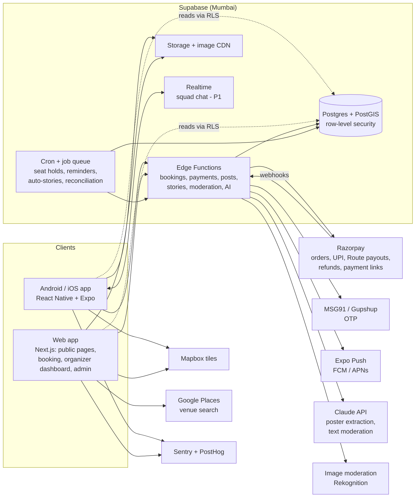
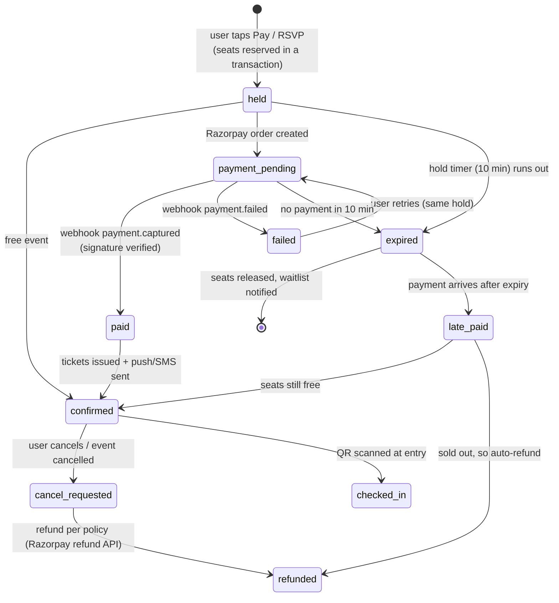

# Nikl: Development Plan

> Companion to [PLAN.md](PLAN.md). Written 21 Nov 2026. Status: **weeks 1–4 done, week 5 in progress** (see §7; what works today: [docs/FEATURES.md](docs/FEATURES.md)). Decisions and their reasons: [DECISIONS.md](DECISIONS.md). Who does what next: [NEXT_STEPS.md](NEXT_STEPS.md).
> Product direction: the social feed version (`prototype/nikl-social.html`), restyled to be calm, clean and low on colour.
> Prices, free tiers and policy details below are from what we know today. **Check them again before signing up for anything.**

---

## 1. Goals & MVP scope

**Launch goal:** Android app + web app live in Bhubaneswar about **12 weeks after kickoff**, with 100+ upcoming events from 30–50 launch partners. iOS follows 2–4 weeks later.

### What ships at launch (P0) vs soon after (P1)

| Area | Launch (P0) | Soon after (P1, ~2 months post-launch) |
|---|---|---|
| **Onboarding** | Interests + area, browse without sign-up, phone OTP when booking/posting | Contact sync (opt-in) to find friends |
| **Home feed** | Club posts + user posts, each event post with an event strip + Book/RSVP; like, save, share (WhatsApp/Instagram/link) | Comments, in-app "Send to friend" |
| **Stories** | Club stories (24h), **auto-stories generated from new events**, "Your plans" stories (user shares an event they're going to) | Story replies to clubs, highlights editor |
| **User posts** | Photo posts (1–5 photos) tagged to an event, club and/or friends; "I'm going" post card generated from a booking. All checked by moderation before going public | Attendee photo albums on event pages, tagged-photos tab on clubs |
| **Explore** | **Map is the default view** (pins, time chips Now/Today/Tonight/Weekend, bottom-sheet list); grid/list toggle; search; category filters | "Surprise me" swipe mode |
| **Event page** | Details, who's going (friends first), going-solo option, directions, add to calendar, save, share | Q&A, reviews after check-in |
| **Booking** | Free RSVP + waitlist; paid tickets with tiers, promo codes, UPI (intent on Android / QR on desktop web), card/netbanking fallback; QR ticket wallet that works offline | Cancellations & refunds self-serve, memberships/passes with UPI AutoPay |
| **Squads** | – | Squad chat with event cards, polls and **pay-your-own-share** |
| **Moments** | – | Short vertical videos (clubs first, then users) |
| **Clubs (organizers)** | Club profile (posts grid, upcoming, highlights), follow, **poster-to-event AI**, recurring events, attendee list, QR check-in, payouts dashboard, broadcast to followers (rate-limited) | Analytics funnel, co-hosts, promo codes UI polish |
| **Activity** | Notifications: friends going, new events from followed clubs, reminders, follows, likes | Weekly "Your weekend" picks (Thursday 6 PM) personalised |
| **Trust & safety** | Verified organizers (KYC via payment gateway), report post/user/event, block user, automated image/text checks, admin moderation queue | Reviews only from checked-in attendees, trust scores |
| **Admin** | Approve organizers, feature events, moderation queue, refunds/disputes, categories | Promoted listings (self-serve) |

### Design rules for the build (from the user's feedback)
- **Calm and clean:** mostly white/black UI (dark mode included), **one accent colour**, colour mainly from event posters and photos.
- **Simple:** 5 labelled tabs (Home · Explore · Moments* · Tickets · You). *Moments arrives in P1, so the launch tab bar has 4 tabs (Home · Explore · Tickets · You).
- **Easy:** every post/story/map pin has a Book button, booking takes 3 taps, and everything is readable on a cheap Android phone in sunlight.

---

## 2. Tech stack

| Layer | Pick | Why | Credible alternative |
|---|---|---|---|
| **Mobile app** | **React Native + Expo** (Expo Router, EAS Build/Submit/Update) | One TypeScript codebase for Android + iOS, over-the-air fixes, fast builds without Macs for Android | Flutter (great performance, but no code sharing with the web app) |
| **Web app** | **Next.js** (App Router) on Vercel, Mumbai region | Server-rendered event/club pages load fast from WhatsApp links, give rich previews (Open Graph images) and rank on Google; the same app hosts the organizer dashboard and admin | Remix / Astro for public pages + a separate React dashboard |
| **Monorepo** | **Turborepo + pnpm**, shared packages: `ui-tokens`, `types` (generated from the DB), `validation` (Zod), `api-client`, `utils` | Mobile and web share types, validation and business rules, so they never drift apart | Nx |
| **Backend & database** | **Supabase** (managed **Postgres + PostGIS**, Auth, Storage, Realtime) in the **Mumbai region**, with all money and booking logic in **server-side TypeScript functions** (Edge Functions) and Postgres functions. Clients only read through row-level security. Every write goes through server functions. | A small team gets the database, auth, storage, realtime chat and an admin console on day one, so most of the 12 weeks go into product. PostGIS handles "events near me" and map bounding boxes natively. Data stays in India. | **Custom NestJS API on AWS (RDS Postgres + PostGIS)**. More control and no platform lock-in, but adds ~3–4 weeks of setup. Because everything is plain Postgres, we can move there later if scale or compliance needs it. |
| **Background jobs** | Supabase cron (`pg_cron`) + a queue table, processed by Edge Functions | Seat-hold expiry, reminders, story generation, payouts reconciliation | Inngest / Trigger.dev, or BullMQ on a small Node worker |
| **Auth** | **Phone OTP**. SMS via **MSG91** (primary) and **Gupshup** (fallback; also offers WhatsApp OTP). Plugged into Supabase Auth through its SMS hook. | Indian providers are cheap and DLT-compliant. A WhatsApp OTP option helps when SMS delivery is slow. | Firebase Auth phone sign-in; Twilio Verify (reliable but costlier in India) |
| **Payments** | **Razorpay** with **Route** (split settlements to each organizer's linked account) | Mature React Native + web SDKs, UPI intent on Android, UPI QR on desktop, cards/netbanking, payment links (for pay-your-share), refunds API, linked-account KYC by API, UPI AutoPay for memberships later | **Cashfree** Easy Split (often cheaper, a good second quote; keep the payment code behind one interface so we can switch) |
| **Maps** | **Mapbox** for the map (custom minimal style, clustering), **Google Places API** only for venue search when organizers create events | Mapbox gives a calm, fully custom map style and a generous free tier (mobile MAU-based). Google has the best Indian place data, and organizer-only use keeps its volume tiny. | **Ola Maps** (India-focused, very low cost, good local data, younger SDKs). **Google Maps** for everything (simplest, strongest place data, costs more per map load at scale). |
| **Media** | Supabase Storage + image transformations (resize/WebP on the fly) behind its CDN. Uploads compressed on-device first. | Posters and photos at several sizes without our own image pipeline | Cloudflare R2 + Cloudflare Images (cheaper bandwidth at scale) |
| **Video (P1, Moments)** | **Mux** or **Cloudflare Stream** (upload, compress, adaptive streaming) | Never build video encoding ourselves | api.video |
| **Push notifications** | **Expo Notifications** (FCM on Android, APNs on iOS); web push later | One API for both platforms, works with EAS | OneSignal (adds segmentation/marketing tools) |
| **Search** | **Postgres full-text search + `pg_trgm`** (typo-tolerant) + PostGIS distance | Enough for one city's events, clubs and areas; no extra service | Typesense or Meilisearch once we're in several cities |
| **Realtime chat (P1)** | **Supabase Realtime** on a `messages` table | Already in the stack; squads are small groups | Stream Chat (faster to build rich chat, paid per MAU) |
| **Moderation** | Images: **AWS Rekognition** content moderation (or Google Cloud Vision SafeSearch). Text: a small **Claude** classification call (**claude-haiku-5-5**), which also handles Odia/Hindi/English mixed text. Plus a report button, block user, and an admin queue in the web app. | Automated checks catch most problems before anything is public. Humans review reports and borderline cases. | Hive Moderation (one vendor for image + text + video) |
| **AI poster → event** | **Claude claude-haiku-5-5** with vision, returning structured JSON (title, date, time, venue, price, category). Escalate to **claude-sonnet-5-5** when Haiku is unsure or the poster is dense. | Cheap and fast for most posters. Sonnet handles hard ones. The organizer always confirms before publishing. | Google Document AI + rules (worse on stylised posters) |
| **Analytics** | **PostHog** (product analytics, funnels, feature flags, session replay on web) | One tool for analytics + gradual rollouts; has an EU/US cloud or can be self-hosted | Mixpanel + LaunchDarkly |
| **Crash & error reporting** | **Sentry** (mobile, web, functions) | Standard, good React Native support | Firebase Crashlytics |
| **Deep links** | Expo Router universal links / Android App Links. Every link is a **real web URL** (e.g. `nikl.app/e/open-mic-14`), which opens the app if installed, otherwise the web page. | Shared links work for everyone with no extra service | Branch.io (paid; adds install attribution) |

---

## 3. Architecture

**Key rules**
- Money and seats change **only** in server functions, inside database transactions, with idempotency keys.
- **Razorpay webhooks are the source of truth** for payment status. The app's "success" screen only waits for the server to confirm.
- Public event and club pages are server-rendered and cached (revalidated when the event changes), so a viral WhatsApp link doesn't hit the database for every view.

---

## 4. Core data model

All tables have `id` (uuid), `created_at`, `updated_at`. Locations use PostGIS `geography(Point)`.

| Table | Key fields | Relations / notes |
|---|---|---|
| **users** | phone (unique, verified), name, username, avatar_url, bio, area, interests[], dob_year, privacy settings, push_tokens | 18+ at launch (see §8) |
| **clubs** | name, handle, kind, category, bio, logo/cover, area, location, verified, rating_avg, razorpay_account_id, kyc_status | The organizer page |
| **club_members** | club_id, user_id, role (`owner`/`admin`/`checkin`), status | Who can manage a club |
| **venues** | name, address, area, location, google_place_id | Reused across events |
| **events** | club_id, title, slug, category, description, poster_url, venue_id, visibility, status (`draft`/`published`/`cancelled`/`ended`), recurrence_rule, tags[], refund_policy, age_limit, women_only | Parent record of an event series |
| **event_occurrences** | event_id, starts_at, ends_at, capacity, seats_taken, status | One row per date (handles "every Sunday") |
| **ticket_tiers** | occurrence_id, name, price_paise, quantity, sold, seats_per_ticket, sale_starts/ends | Early bird, regular, "squad of 4" |
| **bookings** | user_id, occurrence_id, status (see §5), total_paise, fee_paise, hold_expires_at, going_solo, squad_id (nullable), idempotency_key | Locks seats while pending |
| **booking_items** | booking_id, tier_id, qty, unit_price_paise | |
| **payments** | booking_id, provider, provider_order_id, provider_payment_id, method, amount_paise, status, raw_webhook (redacted) | Never stores card/UPI credentials |
| **refunds** | payment_id, amount_paise, reason, provider_refund_id, status | |
| **payouts** | club_id, provider_transfer_id, amount_paise, status, on_hold_until | Route transfers to organizers |
| **tickets** | booking_id, user_id, occurrence_id, code, qr_token, status (`valid`/`used`/`void`), checked_in_at, checked_in_by | One per person admitted |
| **waitlist** | occurrence_id, user_id, position, notified_at | |
| **follows** | follower_id, target_type (`club`/`user`), target_id | |
| **posts** | author_type (`club`/`user`), author_id, kind (`photo`/`event`/`going`), caption, event_id (nullable), club_id tag (nullable), moderation_status, visibility | Club and user posts in one table |
| **post_media** | post_id, url, width, height, blurhash, position, moderation_labels | 1–5 images (video in P1) |
| **post_tags** | post_id, tagged_user_id, accepted | Friends tagged in photos |
| **likes** | user_id, post_id | Unique pair |
| **saves** | user_id, event_id | "Saved plans" |
| **comments** (P1) | post_id / event_id, user_id, body, parent_id, moderation_status | |
| **stories** | author_type, author_id, kind (`event_auto`/`custom`/`your_plan`), event_id, media_url or template data, expires_at | 24h lifetime |
| **story_views** | story_id, user_id | Seen/unseen rings |
| **squads** (P1) | name, created_by | |
| **squad_members** | squad_id, user_id, role | |
| **messages** (P1) | squad_id, sender_id, kind (`text`/`event_card`/`poll`/`pay_request`/`system`), body, payload json | |
| **polls / poll_votes** (P1) | poll: squad_id, options (event ids), closes_at; votes: poll_id, user_id, option | |
| **share_requests** (P1) | squad_id, booking_id, user_id, amount_paise, payment_link_id, status, expires_at | Pay-your-own-share |
| **notifications** | user_id, type, actor, target, read_at, push_sent_at | Activity tab |
| **reports** | reporter_id, target_type, target_id, reason, status, reviewed_by, action | Moderation queue |
| **blocks** | user_id, blocked_user_id | |
| **badges / user_badges** | badge definitions; earned_at | City Passport |
| **audit_log** | actor, action, entity, before/after | Admin and money actions |

---

## 5. Key flows

### 5.1 Booking + UPI payment

- **Seat safety:** `seats_taken` is updated with row locks in the same transaction as the booking. Load-test this for hot events (300 people booking in the same minute).
- **Payments:** Android uses the UPI intent flow (opens GPay/PhonePe/Paytm). Desktop web shows a UPI QR. Mobile web uses intent links. Avoid UPI "collect" requests, which NPCI has been phasing out.
- **Organizer payout (Route):** on capture, create a transfer to the club's linked account **on hold until the event ends + 24h**, so refunds for cancelled events are easy. After that the gateway settles to the organizer's bank. Nikl's fee stays in Nikl's account.
- **Reconciliation job (nightly):** compares our `payments` with Razorpay's records and flags mismatches to admin.

### 5.2 Auto-story from an event
1. Event published → job creates an `event_auto` story for the club (poster + "date · area · price" sticker + Book button), valid 24h.
2. On the event day at 9 AM → a "Today" story. At 80% sold → a "Last few spots" story. Each is limited to 1 per day per event so feeds don't fill with repeats.
3. Stories are **rendered in the app from data** (a template), not stored as images. That keeps them cheap and always up to date (price, spots left). The web renders the same template.

### 5.3 User posts
1. User picks 1–5 photos (compressed on-device) and adds an optional caption, event/club tag and friend tags.
2. Upload → **automatic checks**: image moderation + Claude Haiku text check. Clean posts publish immediately. Borderline ones wait in the admin queue. Clear violations are rejected with a reason.
3. **Tagging an event** is only allowed if the user booked/RSVP'd it (stops spam on event pages). Tagged friends must accept before they appear on their profile.
4. "I'm going" posts are created from a booking with one tap (event card + the user's note). The user decides if it's shown to friends only or public.

### 5.4 Pay-your-own-share (P1)
1. Squad picks an event (poll) → one member taps "Book for N".
2. Server holds N seats for **2 hours** (squad hold) and creates **one Razorpay payment link per member** for their share. Nobody pays for anyone else, and Nikl never pools money.
3. Each member who pays gets their own ticket right away. Reminders/nudges go out at 1h and 15 min left.
4. When the hold ends, unpaid seats are released to the public/waitlist. The squad sees who's in.

### 5.5 Check-in QR
- QR contains a **signed token** (`ticket_id`, `occurrence_id`, expiry, Ed25519 signature).
- The organizer app downloads the event's public key and ticket list before doors open, so **scanning works offline**. It checks the signature, marks used locally and syncs when online.
- A duplicate scan shows "Already checked in at 7:42 PM by Ankit (door 1)". Manual lookup by name/phone is available as a fallback.

### 5.6 Feed ranking v1 (rules, no ML)
**Candidates:** posts from followed clubs and friends (last 7 days), upcoming events from followed clubs, plus suggested items (nearby, matching interests, friends going).

| Signal | Effect |
|---|---|
| Newer post | Higher (decays over ~48h) |
| Friends liked/going | Strong boost |
| Event happening in the next 72h | Boost |
| Distance from user's area | Closer is higher |
| Matches user's interests | Boost |
| Past event (already ended) | Hidden from the feed, except user photo posts |
| Same club twice in a row | Not allowed. Max 2 per club per screen. |
| Suggested content | 1 in every 5 items, labelled "Suggested" |

All weights live in config (remote-tunable via PostHog feature flags). Revisit after 4 weeks of data.

---

## 6. Web vs app at launch

| Feature | App | Web (no install) |
|---|---|---|
| Browse feed, explore map/list, search | ✅ | ✅ explore map/list and search; the feed stays in the app for now (D9) |
| Event & club pages | ✅ | ✅ server-rendered, rich WhatsApp/Instagram previews |
| Follow, like, save | ✅ | ✅ follow and save (after phone OTP); likes and the feed are in the app (D9) |
| RSVP & paid booking with UPI | ✅ UPI intent | ✅ UPI QR (desktop) / intent link (mobile web) / cards |
| Tickets & QR | ✅ offline wallet | ✅ ticket page + SMS link (online only) |
| Stories | ✅ watch + post | ✅ watch only |
| User photo posts | ✅ | ❌ (later) |
| Push notifications | ✅ | ❌ (SMS/WhatsApp for booking confirmations instead) |
| Squad chat (P1) | ✅ | ✅ read & pay share via link |
| Moments (P1) | ✅ | ✅ watch only |
| **Organizer dashboard** (create events, poster AI, attendees, payouts, analytics) | ✅ core actions | ✅ **full dashboard (main place for organizers)** |
| QR check-in scanner | ✅ (organizer app mode) | ❌ |
| Admin & moderation | ❌ | ✅ (internal) |

Every web page shows a light "Open in app" banner. The web is a complete way to book, not a "please install" wall.

---

## 7. Team & timeline

### Team (lean)
| Role | Count | Main responsibilities |
|---|---|---|
| Founder / product owner | 1 (you) | Priorities, organizer partnerships, acceptance testing, launch |
| Product designer (UI/UX) | 1 | Design system (calm, minimal colour), all screens, usability tests. **Starts 2 weeks before devs.** |
| Mobile / full-stack engineer (React Native) | 2 | App screens, feed, stories, map, booking UI, tickets, check-in |
| Backend engineer (Postgres/TypeScript) | 1 | Schema, server functions, payments + Route, jobs, moderation, AI extraction |
| Web engineer (Next.js) | 1 (or one of the full-stack engineers part-time) | Public pages, web booking, organizer dashboard, admin |
| QA engineer | 0.5 | Test plans, device lab (low-end Android), payment testing, Maestro/Playwright tests |
| Community/ops (from week 8) | 0.5 | Organizer onboarding, moderation queue, support |

### MVP timeline (12 weeks from kickoff)

| Week | Focus | Milestone |
|---|---|---|
| −2 to 0 | Design system, final screens for P0, clickable test with 10 students + 5 organizers | Design sign-off |
| 1 | Monorepo, CI/CD, Supabase (dev/staging/prod), schema v1, phone OTP, app shell + web shell | Login works on all three |
| 2 | Clubs, venues, events + occurrences, organizer web dashboard (create/edit), **poster-to-event AI** | Organizers can create events |
| 3 | Explore: **map default** + list/grid, search, filters; event page (app + web, server-rendered) | Browse real data |
| 4 | Feed v1 (club posts), follow, like, save, club profiles | **M1: internal alpha** |
| 5 | Stories (club + auto + "Your plans"), **user photo posts**, moderation pipeline + report/block | Social layer working |
| 6 | Booking: holds, tiers, promo codes, Razorpay orders, UPI intent/QR, webhooks | Test-mode payments end to end |
| 7 | Tickets + offline QR, check-in scanner, Route linked accounts + organizer KYC, payouts dashboard, refunds | **M2: money flow complete** |
| 8 | Notifications + activity, reminders, deep links, share pages + Open Graph images, waitlist | Feature complete |
| 9 | Admin (moderation queue, refunds, featuring), analytics events, profile + City Passport basics | |
| 10 | **Feature freeze.** QA on 6+ low-end Android phones, performance, accessibility, live-mode payments with small real amounts | Release candidate |
| 11 | **Closed beta**: 30–50 organizers + ~200 students, onboard launch events, fix issues | **M3: beta** |
| 12 | Play Store release + web launch in Bhubaneswar | **M4: launch** |
| 13–15 | iOS: TestFlight, App Store review, fixes | iOS live |
| 16–24 | P1: squad chat + pay-your-share, comments, Moments, memberships, reviews | |

The schedule is tight, but realistic with the stack above if scope stays at P0. Anything new goes to P1 by default.

### Week 1 status (21 Nov 2026): codebase set up

| Item | Status |
|---|---|
| Monorepo (Turborepo + **pnpm 12**, isolated installs) with `apps/web`, `apps/mobile`, `packages/{tokens,utils,validation,supabase}` | ✅ Done |
| Versions in use | Next.js **16.4** (Cache Components on), Expo **SDK 58** / React Native 0.88 / Expo Router, React 19.3, TypeScript 6.0, supabase-js 2.119, Supabase CLI 2.122 |
| Schema v1: 30 P0 tables, RLS on every table, 66 policies, Bhubaneswar seed | ✅ Running on local Supabase (Postgres 17, PostGIS 3.3) and **pushed to the hosted `nikl-dev` project** with seed data. `db lint` on `public`: no issues. Follow-up migration stores phones as `+91…` (S3). |
| Phone OTP login (shared helpers, web + mobile screens) | ✅ **Works end to end on the web against local Supabase** (test number → code → account page). Signup creates the profile; phone is only in `profiles_private`; logged-out visitors can't read it or create bookings. Mobile login is built and bundles, but hasn't been tried on a phone yet. |
| Typed database access | ✅ `packages/supabase/src/database.types.ts` generated from the local database (`pnpm db:types`). |
| App shell (Home · Explore · Tickets · You) + web shell (home, login, account) | ✅ Done |
| CI (GitHub Actions: typecheck, lint, tests, web build, migrations) | ✅ Written. Runs on the first push to GitHub. |
| Checks run locally | typecheck + lint + 16 unit tests pass; `next build` passes (all pages static); Android bundle exports; `expo-doctor` 20/20 |
| Hosted Supabase `nikl-dev` (ref `ypnbsmlvcrbzqpomqlwd`) | ✅ Created by the founder, linked and migrated. Phone login there stays off until MSG91 is ready. |
| Staging / prod Supabase projects, EAS project, Vercel project, GitHub repo | ⏳ Need accounts / founder decisions (see NEXT_STEPS.md) |

### Week 2 status (21 Nov 2026): organizers can create events

| Item | Status |
|---|---|
| Club pages with Nikl approval (P15): create page → hidden until approved → admin approves → club, events, posts and stories go public | ✅ Built and tested end to end in the browser |
| Organizer web dashboard: club status, events list, create event (poster, details, weekly repeats, free/paid tiers, draft/publish), manage event (edit details, publish/draft/cancel/restore, cancel single dates) | ✅ Built and tested in the browser |
| Nikl admin page: review queue, approve / ask for changes (with note); every decision is recorded in the `audit_log` table (no screen for it yet) | ✅ Built and tested |
| Server-side sessions on the web (proxy refreshes cookies; pages read the user inside `<Suspense>`) | ✅ |
| Poster-to-event (Supabase Edge Function `extract-event`, Claude Haiku 5.5 with structured output, verified login, 30 reads per person per day) | ✅ Built. Login, ownership and limit checks tested. **The real Claude call hasn't run yet**: it needs your Anthropic key. Locally it returns sample details. |
| Mobile profile set-up after first login (name, username, area, 3+ interests, birth year for 18+) | ✅ Built, typechecks. Not yet tried on a phone. |
| Database tests (pgTAP): 27 tests for club approval, event creation and profile rules, run in CI | ✅ |
| Independent code review (T22): 9 findings (5 important: poster function auth, open redirect, poster URLs, restore event, duplicate interests), **all fixed** | ✅ |
| Public event and club pages, map | ✅ Week 3 (below) |

### Week 3 status (21 Nov 2026): browse real data

| Item | Status |
|---|---|
| Database: venue pins (`venues.lat/lng`), `create_event` takes a pin, `explore_events()` (next date of every public event in 60 days, with price, spots left, club), `set_event_pin()` to add or move a pin later | ✅ Migration `20261121050000`; 12 new database tests (39 in total) |
| Web **Explore** (`/explore`): Mapbox map by default (category pins, tap → card), Map/Grid switch, filters (Any time, Happening now, Today, Tonight, This weekend, Next 7 days, Free, categories), search, empty state | ✅ Tested in the browser: filters, search, pins, phone width |
| Web **event page** (`/e/[slug]`): poster, club, dates and prices, venue with map image and directions, share + WhatsApp, "Booking opens soon"; WhatsApp/Google previews (title, date, venue, poster) | ✅ Popular pages prebuilt; others built on first visit and cached |
| Web **club page** (`/c/[handle]`) and **home** "This weekend" picks (falls back to "Coming up") | ✅ |
| Organizer: tap-the-map venue pin when creating an event, and a "Map pin" panel on the manage page | ✅ Tested end to end: the pin shows on Explore straight after saving |
| Public pages stay fast (cached) and update the moment an organizer or admin changes something (T24) | ✅ Tested: publish → appears, cancel → disappears |
| Mobile: Explore list (search, same filters, pull to refresh), event screen (Open in Maps, share), home "This weekend" | ✅ Typecheck, lint and Android bundle pass. **Not yet tried on a phone.** |
| Mobile **map** (26 Nov, T25/T26): `@rnmapbox/maps` with emoji pins, tap → event card, Map/List switch, refresh, fanned-out pins at the same venue; Expo Go falls back to the list. EAS build profiles (development / preview / production) | ✅ Typecheck, lint, Expo Doctor 20/20, Android bundle pass; config plugin loads. **Needs the first test build (NEXT_STEPS 1.7) to be seen on a phone.** Known: the mobile app's own web export fails on `localStorage` during server rendering (existing; the website is `apps/web`, so no user impact). Android storage permissions come from Expo defaults; review before the Play Store listing. |
| AI poster reading | ⏸ On hold (T23); button hidden |
| Independent code review (T22): 9 findings (3 important: Explore filter stuck after navigating, ended paid events shown as "Free", list hover moving the map), 8 fixed; the repeating-events filter limit is logged as an open question | ✅ |

### Week 4 status (27 Nov 2026): the social layer (M1: internal alpha)

| Item | Status |
|---|---|
| Database: one-tap `set_follow_club` / `set_like` / `set_save`, `create_club_post` (photos only from Nikl storage, S13), ranked `home_feed` (T28), `suggested_clubs`, `post-media` storage bucket | ✅ Migration `20261127000000`; 16 new database tests (55 in total) |
| **App Home = Instagram-style feed** (D9): club stories row, post cards (club header + Follow, photo or poster, event strip with Book/RSVP, like · comment · share · save, likes, caption, time), "Clubs you might like", "You're all caught up" | ✅ Typecheck, lint, Android bundle pass. **Not yet seen on a phone.** |
| App club profile (avatar, upcoming / followers / rating, Follow, posts grid, upcoming events), Save on the event screen, **Saved** list under You | ✅ Same checks. Not yet seen on a phone. |
| Web: Follow (with live follower count) on club pages, Save on event pages, club posts grid; organizer **New post** (photo, event, caption) and a Posts panel with likes and delete | ✅ Tested in the browser: follow / save / post / delete; deleting also removes the photo file |
| Sample data: events always in the coming week, sample stories stay up two weeks after a reset | ✅ |
| Independent reviews (T22): database + web 7 findings (3 important: deleted photos still reachable, silent delete failures, photo posts tied to an event by default) and app 6 findings (2 important: share links to a domain Nikl doesn't own yet, a stuck spinner after logging out mid-refresh); 9 fixed, 4 left with reasons | ✅ |
| Not yet: story viewer, user posts and "+" create (week 5), comments (P1), web feed for logged-in people (D9) | ⏳ |

### Week 5 status (27 Nov 2026): stories, people's posts, moderation

| Item | Status |
|---|---|
| Database: stories (club, automatic on first publish, "Your plans"), `story_feed` + seen, people's photo posts (tag a saved event, public/friends), following people, friends = mutual follows, follow and like lists private with public counts, reports (3 people hide), blocks, review switch, admin queue (`moderation_queue`, `moderate_content`, `open_reports`, `resolve_report`) | ✅ Migration `20261127010000`; 40 new database tests (95 in total) |
| App: big story circles with "Your plans" and seen rings, full-screen story viewer, "+" → New post (1–5 photos, shrunk to 1080 px) and Share your plans, person profiles and post screen, ⋯ menu (report, block, delete), You tab with your posts and their review status | ✅ Typecheck, lint, unit tests, Android bundle; app calls checked against the local database (40 checks). **Not yet seen on a phone.** |
| Web: `/admin/moderation` (switch, queue with photos, approve/remove with reason, other reports), organizer **New story** and a Stories panel, counts from public functions | ✅ Tested in the browser: story, queue, removal (reason, notification, photos deleted), switch |
| Guides: `docs/FEATURES.md` and `docs/DEVELOPING.md` (updated every chunk from now on) | ✅ |
| Independent reviews (T22): database + web 5 findings (removed photos stayed public; who-liked-what was public; club teams weren't told about removals; restore re-created the "New" story), app 5 findings (delete could wipe photos of a post that wasn't deleted); 8 fixed, 2 left with reasons | ✅ |
| Not yet: story replies, "Join me", friend tags, private accounts / follow requests, "Today" and "Last few spots" automatic stories (need a scheduler), activity screen (week 8) | ⏳ |
| Known: Expo Doctor flags a few Expo patch versions newer than our 2-week package age rule (e.g. expo 58.1.0, expo-crypto 58.0.9); update with `npx expo install --fix` once they're old enough | ⏳ |

### Week 6 status (28 Nov 2026): booking and payments (test mode)

| Item | Status |
|---|---|
| Database: `quote_booking`, `hold_booking` (10-minute holds with row locks, idempotent, profile + age checks), `expire_holds` every minute (pg_cron), promo codes, `my_bookings`, ticket codes, payment functions (`start_payment`, `payment_captured` with late-payment handling, `payment_failed`, webhook de-dupe) | ✅ Migration `20261128000000`; 26 new database tests (121 in total) |
| `payments` server function: Razorpay order, checkout signature check, webhooks (signature + de-dupe), pretend payments locally; off unless `PAYMENTS_MODE` is set | ✅ Mock mode tested end to end; **real Razorpay not tried yet (needs your test keys, NEXT_STEPS 2.4)** |
| Web: Book/RSVP, booking page (dates, tickets, promo, live price), pay page (also used by the app), Tickets page with entry codes, web profile set-up, organizer promo codes | ✅ Tested in the browser: free RSVP, paid booking with a failed then successful pretend payment, tickets, promo code creation |
| App: Book/RSVP on the event screen, booking screen, Tickets tab (in progress with countdown, upcoming with codes, past) | ✅ Typecheck, lint, tests, Android bundle; database calls checked by script. **Not yet seen on a phone.** |
| Independent reviews (T22): 7 findings (2 important: tapping Pay again kept seats held forever; a reused key returned an expired booking); 6 fixed, women-only enforcement logged as an open question | ✅ |
| Not yet: QR codes and check-in, refunds and payouts, waitlist, attendee list for organizers (week 7) | ⏳ |

Decisions made during setup:
- Phone numbers and year of birth sit in an owner-only `profiles_private` table, and Razorpay details in an admin-only `club_payout_settings` table. `profiles` itself is public.
- The web app reads the session in the browser for week 1. Server-side session checks (behind `<Suspense>`, as Cache Components requires) arrive with the organizer dashboard in week 2.
- Supabase's newer "publishable key" naming is used for the public key (`*_SUPABASE_PUBLISHABLE_KEY`).

---

## 8. Engineering practices

### Environments & CI/CD
| Env | Purpose | Payments |
|---|---|---|
| **dev** | Local + shared dev database | Razorpay test mode |
| **staging** | Mirrors prod; beta testers and organizers rehearse here | Razorpay test mode |
| **prod** | Live | Razorpay live mode |

- **GitHub Actions:** lint, type-check, unit tests and database migration checks on every pull request.
- **Previews:** Vercel preview URL for web and EAS preview build for mobile on each PR.
- **Database changes** only through versioned Supabase migrations (no manual edits in prod).
- **Releases:** EAS Build + Submit to the Play Console. **EAS Update** for JS-only hotfixes (store releases for native changes).
- Feature flags (PostHog) for risky features and gradual rollouts.

### Testing
| Type | Tool | Must cover |
|---|---|---|
| Unit | Vitest | Pricing, fees, refund rules, feed scoring |
| Database & functions | Vitest against local Supabase (or pgTAP) | Seat holds, row-level security, booking state changes |
| Payments | Webhook replay tests (recorded test-mode payloads) | Captured, failed, late, duplicate and out-of-order webhooks |
| Mobile end-to-end | Maestro | Onboard → explore map → book (test mode) → ticket |
| Web end-to-end | Playwright | Event page → book → ticket; organizer creates event |
| Load | k6 | 300 concurrent bookings on one event, no overselling |
| Manual | Device lab | 2–3 GB RAM Android phones, slow 4G, Odia/Hindi text rendering |

### App store steps
- **Google Play:** register an **organisation** developer account (needs a D-U-N-S number; org accounts skip the 12-tester/14-day closed test that new personal accounts need). Fill in Data safety, content rating and target audience (18+). Use internal → closed → production tracks.
- **Apple:** Apple Developer Program as an organisation (D-U-N-S). Paying for real-world events with Razorpay is allowed (no in-app purchase needed for physical services). Apps with user posts **must** have report, block and content filtering (we have them). Phone-OTP-only login means "Sign in with Apple" isn't required.
- Store listings in English first, with Odia/Hindi screenshots later.

### Security & privacy (DPDP Act 2023 basics)
- **Consent & notice:** a clear, plain-language privacy notice at sign-up, and separate opt-ins for contacts and location. Users can withdraw consent.
- **Data minimisation:** phone number, name and interests only. Location is coarse and used only for the map. Contact sync is optional and phone numbers are hashed.
- **User rights:** in-app download my data, correct profile, delete account (with posts/messages removed or anonymised).
- **Children:** **accounts are 18+ at launch** to avoid the Act's verifiable-parental-consent rules. Under-18 support can come later with a proper consent flow.
- **Breach handling:** an incident runbook, and notification to the Data Protection Board and affected users as required. Appoint a grievance officer (contact in the app).
- **Data location:** primary database and storage in India (Mumbai region).
- **Payments:** card/UPI details never touch our servers (Razorpay checkout handles them). We store only gateway IDs and status. Webhook signatures are always verified.
- **Platform security:** row-level security on every table, secrets in a vault (never in the app bundle), rate limits on OTP/booking/posting, signed and expiring upload URLs, and an audit log for admin and money actions.

> Get a lawyer/CA to review the privacy notice, terms, refund policy, GST/TCS treatment and the Razorpay marketplace setup before launch.

---

## 9. Rough monthly running cost (~10,000 MAU)

**These are estimates.** Prices change, so get quotes. Salaries and payment-gateway fees are not included.

| Item | Est. INR / month | Notes |
|---|---|---|
| Supabase (Pro + compute/storage add-ons) | ₹3,000 – 12,000 | Grows with database size and bandwidth |
| Vercel (Pro, team seats) | ₹2,000 – 6,000 | Public pages are cached |
| Expo EAS (builds, OTA updates) | ₹2,000 – 9,000 | Starter vs Production plan |
| SMS/WhatsApp OTP | ₹1,000 – 4,000 | ~₹0.15–0.30 per SMS + one-time DLT registration |
| Maps (Mapbox + Google Places) | ₹0 – 6,000 | Likely within Mapbox's free tier at this size; Places is organizer-only |
| Image storage + CDN bandwidth | ₹2,000 – 8,000 | Biggest variable as user posts grow |
| Image moderation | ₹1,500 – 4,000 | ~20–30k images/month |
| Claude API (poster extraction + text moderation) | ₹1,000 – 5,000 | Haiku for most calls |
| Sentry + PostHog | ₹0 – 5,000 | Free tiers may be enough at first |
| Store accounts | ~₹700 / month | Apple ~$99/year; Google $25 one-time |
| **Total** | **≈ ₹13,000 – 63,000 / month** | |

**Variable, passed through:** payment-gateway fees (UPI is often low/zero MDR, cards ~2%, plus any Route transfer fee). Negotiate with Razorpay and Cashfree before launch. These are covered by the booking fee.

**Biggest cost drivers as we grow:** image/video bandwidth (Moments especially), moderation volume and map loads. Plan a cost review at 25k MAU.

---

## 10. Risks & open questions

### Risks
| Risk | Mitigation |
|---|---|
| **Overselling hot events** | Transactional seat holds, a load test before launch, waitlist |
| **Payment edge cases** (late/duplicate webhooks, UPI app returns without confirming) | Webhooks are the source of truth, idempotency keys, nightly reconciliation, auto-refund for late payments |
| **Organizer KYC delays block payouts** | Start Route onboarding for launch partners in week 2. Free events don't need KYC. |
| **Harmful or spammy user posts** | Automated checks before publishing, event tags only for attendees, report/block, admin queue staffed from beta |
| **Feed feels empty** | Auto-stories and event posts from every published event, so even quiet clubs show up. 100+ events before launch. |
| **Low-end Android performance** | FlashList, expo-image with caching, image size limits, Hermes, regular testing on 2–3 GB RAM phones |
| **Vendor lock-in (Supabase)** | Plain Postgres + SQL migrations, so we can move to self-managed Postgres/NestJS if needed |
| **SMS delivery issues (DLT)** | Register DLT templates in week 1, use two OTP providers, WhatsApp OTP fallback |
| **App Store review for user posts** | Moderation, report, block and terms in place before submission |

### Open technical questions (decide by week 2)
1. **Razorpay vs Cashfree:** get both quotes (UPI/card fees, Route/split fees, settlement time).
2. **Mapbox vs Ola Maps:** quick test of map style, Indian place data and pricing on a real Bhubaneswar map.
3. **Booking fee:** charged to the attendee or absorbed by the organizer (per-event setting?), and the exact GST/TCS treatment (with the CA).
4. **Ticket holds:** 10 minutes standard / 2 hours for squads. Check these with organizers.
5. **Domain & handles:** `nikl.app` / `nikl.in` availability decides the deep-link domain.
6. **Languages:** English UI at launch, or English + Odia from day one?
7. **Minimum age:** confirm 18+ at launch. Many first-year college students are 17, so decide whether that's acceptable.
